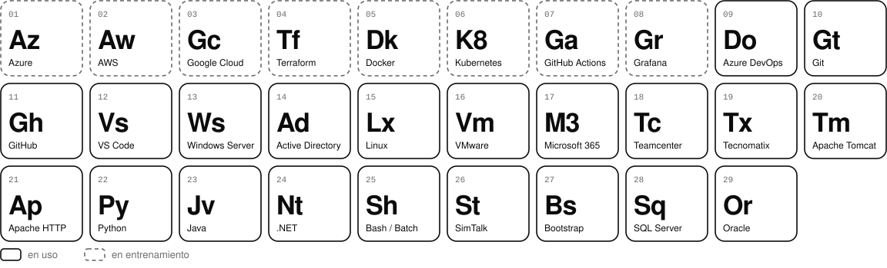

  

  <a href="https://ryancloudops.github.io/"><picture><source media="(prefers-color-scheme: dark)" srcset="assets/btn-portfolio-dark.svg"></picture></a>
  &nbsp;
  <a href="https://ryancloudops.github.io/cv-gary-flores.pdf"><picture><source media="(prefers-color-scheme: dark)" srcset="assets/btn-cv-dark.svg"></picture></a>
  &nbsp;
  <a href="https://www.linkedin.com/in/gary-bryan-flores-pe%C3%B1afiel"><picture><source media="(prefers-color-scheme: dark)" srcset="assets/btn-linkedin-dark.svg"></picture></a>
  &nbsp;
  <a href="mailto:pflores.gary@gmail.com"><picture><source media="(prefers-color-scheme: dark)" srcset="assets/btn-email-dark.svg"></picture></a>

 

## Hola, soy Gary.

<table>
<tr>
<td width="360" valign="top"></td>
<td valign="middle">

**Systems Engineer** en **Sothis** (PLM, Barcelona). Opero plataformas **Siemens Teamcenter y Tecnomatix** sobre Windows Server, Active Directory, Tomcat y SQL Server. Ahora llevo esa base a **Azure, AWS y DevOps**, rumbo a **Cloud Architect**.

> *Mantengo en pie los sistemas de los que dependen equipos de ingeniería. Ahora llevo esa misma fiabilidad a la nube.*

EN

Systems Engineer at Sothis (PLM, Barcelona). I run Siemens Teamcenter and Tecnomatix on Windows Server, Active Directory, Tomcat and SQL Server, and I'm taking that foundation to Azure, AWS and DevOps, aiming for Cloud Architect.

*I keep the systems that engineering teams depend on running. Now I'm bringing that same reliability to the cloud.*

</td>
</tr>
</table>

  

   cloud architect. $ kubectl get pods -n career → systems-engineer 1/1 Running · cloud-engineer 0/1 ContainerCreating · cloud-architect 0/1 Pending">

 

## Skills

  <picture>
    <source media="(prefers-color-scheme: dark)" srcset="assets/periodic-dark.svg">
    
  </picture>

**Nube:** Azure como principal · AWS en formación · GCP en la ruta.

 

## Experiencia

  

 

## Certificaciones y objetivos

  

## Roadmap

  

 

## Contacto

  

  <a href="https://ryancloudops.github.io/"><picture><source media="(prefers-color-scheme: dark)" srcset="assets/btn-portfolio-dark.svg"></picture></a>
  &nbsp;
  <a href="https://ryancloudops.github.io/cv-gary-flores.pdf"><picture><source media="(prefers-color-scheme: dark)" srcset="assets/btn-cv-dark.svg"></picture></a>
  &nbsp;
  <a href="https://www.linkedin.com/in/gary-bryan-flores-pe%C3%B1afiel"><picture><source media="(prefers-color-scheme: dark)" srcset="assets/btn-linkedin-dark.svg"></picture></a>
  &nbsp;
  <a href="mailto:pflores.gary@gmail.com"><picture><source media="(prefers-color-scheme: dark)" srcset="assets/btn-email-dark.svg"></picture></a>

© RyanCloudOps

